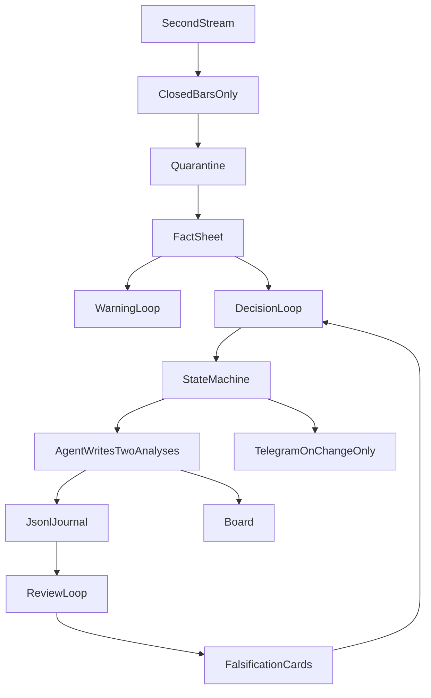
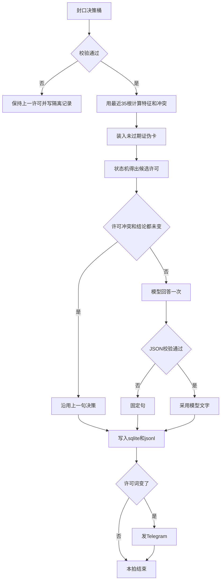

# 日内交易辅助系统开发文档

| 项目 | 内容 |
| --- | --- |
| 文档地位 | 开发规格。产品边界与许可词以 [日内交易辅助agent.md](日内交易辅助agent.md) 为准 |
| 配套原型 | [日内交易辅助agent-prototype.html](日内交易辅助agent-prototype.html) 只对照出口，不接行情 |
| 更新日期 | 2026-11-11 |
| 运行形态 | 个人单机。不下单、不报股数 |
| 执行默认 | 预警 1 分钟，决策 3 分钟。可配，盘中锁定 |

产品文档里的「5 分钟收盘才改许可」是确认原则：许可只在**决策周期收盘**时变。V0 可执行的周期、阈值、字段与拍序以本文为准。

---

## 0. 地位与非目标

| 文档 | 管什么 |
| --- | --- |
| 产品设计 | 做什么、五种许可词、开仓与持仓分开、不代下单 |
| 本文 | 按什么顺序做、每一拍读什么、失败时状态怎么留 |
| 原型 | 预警段与决策段的阅读顺序 |
| 产品文档附 D | 一周仪式与成功定义。文件与阈值以本文第 2、10 节为准 |

**不做**

- 券商下单、报股数、市价、止盈价
- 短于 1 分钟的许可变更（秒级只入桶）
- 盘中自动改量比、根数等阈值
- 用模型记忆恢复状态（只从 jsonl 恢复）
- 新闻作为「允许开」的条件
- 多用户、支付、期权、券商只读持仓

许可词只有：不操作、允许开、持有、减仓许可、结构失效。对应状态见第 7 节。

---

## 1. 四条循环

盘中不是一轮长对话。只有决策循环能改许可。



| 循环 | 何时跑 | 能改什么 | 不能改什么 |
| --- | --- | --- | --- |
| 行情 | 秒级流持续 | 未收盘桶 | 不调用模型，不改许可 |
| 预警 | 预警 K 收盘 | 覆盖预警段 | 不改许可、不发 Telegram |
| 决策 | 决策 K 收盘 | 候选许可、决策段、状态机 | 不改阈值 |
| 复盘 | 该笔之后第 6 根决策 K，或人工标误报 | 写证伪卡、MFE/MAE | 证伪卡本拍不生效，下一拍才进入上下文 |

### 1.1 每一拍的顺序

决策拍与预警拍共用前三步。预警拍到第 4 步为止，不跑状态机。

1. **只取已收盘的桶。** 未收盘的秒留在桶内。
2. **校验。** 不合格则该标的本拍隔离，许可保持上一拍。见第 4 节。
3. **装上下文。** 槽位与上限见第 8 节。超限丢最旧的，不截断事实单数字。
4. **预警拍：** 用固定句或 agent 覆盖预警段，写明「许可未改」。结束。
5. **决策拍：** 规则先跑状态机，得到候选许可。agent 只把候选许可写成决策段。不得把「不操作」写成「允许开」。
6. **冲突时以状态机为准。** 文字与候选许可或 `setup_read` 不一致：丢弃该段文字，用 `prompts/card.txt` 的固定句重写。不重跑模型。
7. **许可与上一拍不同**才发 Telegram。预警只更新看板。
8. **本拍写入 jsonl：** 事实单、特征、候选许可、最终文字、规则版本、是否隔离。见第 10 节。

进程中断后，下一拍从当日 jsonl 最后一条有效状态恢复。不从聊天记录恢复。

### 1.2 谁在哪一阶段写文字

| 阶段 | 预警段与决策段 |
| --- | --- |
| P0 | 固定句模板填事实单数字。不调用模型 |
| P1 起 | 模型只改写已由状态机决定的许可。数字必须能在本拍事实单中找到 |

### 1.3 Agent 循环

这里的循环不是「模型思考、调用工具、再看结果」的多轮循环。工具在调用模型之前已经跑完。模型每拍最多回答一次，回答不合格就改用固定句，不再问第二次。多轮工具调用会让模型自己去找行情，从而写出事实单里没有的数字。

一天的外层顺序：

1. **开盘装载。** 读入时钟、规则、时段、持仓标记和 `llm.yaml`。从当日 jsonl 恢复每只票的 `state`、作废价、`bars_left`。从 `market.sqlite` 取出每只票最近 35 根决策 K，不够则当日不得出现「允许开」。
2. **秒级只入内存桶。** 这一层不调用模型。
3. **预警桶收盘**走预警拍。**决策桶收盘**走决策拍。两拍可以落在同一分钟：先写完该标的的预警拍，再写决策拍，避免决策文字引用尚未落地的预警。
4. **收盘后**不再开新拍。未封口的桶丢弃，不补写许可。

单只标的的决策拍按下面的顺序执行。任何一步失败都停在该步，不进入模型。



| 步 | 做什么 | 失败时 |
| --- | --- | --- |
| 1 | 桶封口。缺失秒数大于 5、零量、价差交叉、双源冲突则隔离 | 许可不变，写 `quarantine: true`，不调用模型 |
| 2 | 用本标的最近 35 根决策 K 计算第 6 节特征、`conflicts`、`setup_read` | 动量字段为 `null` 时，`setup_read` 不能是 `reclaim_ok` |
| 3 | 读取最多 3 张未过期证伪卡。命中则在状态机之前取消「允许开」 | 卡文件读失败则本标的本拍隔离，不用空卡列表假装没有误报 |
| 4 | 状态机结合时段闸、同簇、持仓标记、冷却、日 cap，得到候选 `label` | 闸门之间冲突时取更严的结果：能不开就不开 |
| 5 | 若 `label`、`conflicts`、`setup_read` 都与上一决策拍相同 | 不调用模型，复制上一句决策，仍写一行 jsonl |
| 6 | 组装第 8.2 节的单个 JSON，模型回答一次 | 超时、非 JSON、字段不符：改固定句，不重试 |
| 7 | 写入 `bars`、`features` 和 jsonl。仅当 `label` 变化时发 Telegram | 写入失败则本拍不发 Telegram，下一拍不得把未落盘的许可当成已发送 |
| 8 | 若这根是某笔许可之后的第 6 根决策 K，计算 MFE/MAE，留给复盘循环 | 复盘不在模型请求内部进行 |

预警拍更短：封口、校验、只算 `_w` 特征。与上一预警拍相比这些特征没变，就复制上一句。有变化才组 `task=warning` 的 JSON，模型回答一次，同样不重试。预警拍不读证伪卡，不跑状态机，不发 Telegram。

复盘循环挂在决策拍第 8 步之后，或者由人随时写入。它只追加证伪卡。卡要到**下一根**决策 K 的第 3 步才被读到，避免同一拍里「刚判错又用这张卡改写已经发出的许可」。

观察名单上的标的按符号字典序逐只跑完上面的拍。一只失败不影响下一只。同一决策时刻不并行调用模型，便于日志顺序和限速稳定。

---

## 2. 开发阶段

按顺序做。上一阶段的回放夹具没过，不进入下一阶段。

### P0 事实单与状态机

**入口：** 无。

**本阶段创建**

- `config/watchlist.yaml`
- `config/clocks.yaml`
- `config/rules.yaml`
- `config/sessions.yaml`（时段闸、提前收盘日）
- `jobs/bar_loop.py`（可用已收盘的历史 1 分钟 K 聚合成决策桶，先不接秒级流）
- `inbox/YYYY-MM-DD.jsonl`
- `state/positions.yaml`（手动标记持仓）
- `prompts/card.txt`（固定句，禁止新增数字）

**不创建：** 行情长连接、`corrections/`、模型调用。

**完成标准**

- 同一事实单重复跑，许可、`setup_read` 与 `conflicts` 相同。动量不足 35 根时不得出现允许开。
- 未标记持仓的标的不会出现「减仓许可」。
- 午盘闸打开时，候选「允许开」被改写为「不操作」，已有「持有」「减仓许可」保留。
- 脏数据夹具不把许可往上提。

### P1 模型只写两段

**入口：** P0 夹具全绿。

**增加：** `prompts/writer.txt`。模型输入只有第 8 节允许的格子，其中「本拍事实」含第 6 节算好的特征。输出两段文字。校验失败则回退固定句。

**完成标准：** 抽 20 条 P0 夹具，许可与 P0 一致；文案中每个数字都能在事实单中指到。

### P2 秒级流与预警桶

**入口：** P1 完成，或在无模型时直接从 P0 接入（预警也用固定句）。

**增加：** `jobs/ingest.py`。秒级只写入桶。预警周期收盘覆盖预警段。决策周期仍按 P0 状态机。

**完成标准：** 断线 30 秒后续跑，不重复发同一许可；缺一秒不另造一根 K。

### P3 证伪卡回灌

**入口：** P0 状态机已稳定。可与 P2 并行，但夹具先用录好的 jsonl，不依赖实盘。

**增加：** `jobs/review.py`、`corrections/YYYY-MM-DD.jsonl`。

**完成标准：** 标成误报的下一决策拍，匹配模板降为「不操作」，决策段写明证伪卡 id。量比阈值在盘中不变。

---

## 3. 模块与目录

```
config/watchlist.yaml      # P0 符号、分组、in-play 上限
config/clocks.yaml         # P0 预警/决策周期，盘中锁定
config/rules.yaml          # P0 模板阈值、冷却、EXPIRED 根数
config/sessions.yaml       # P0 时段闸、提前收盘
state/positions.yaml       # P0 手动持仓标记
prompts/card.txt           # P0 固定句
prompts/writer.txt         # P1 系统提示，只含宪法
config/llm.yaml            # P1 模型、温度、输出长度
jobs/bar_loop.py           # P0 收盘拍
jobs/ingest.py             # P2 秒级入桶
jobs/review.py             # P3 第 6 根与误报
data/market.sqlite         # P0 已收盘 K 线与特征，按标的和时间查询
inbox/YYYY-MM-DD.jsonl     # 每拍一条，只作审计与回放
corrections/YYYY-MM-DD.jsonl  # P3
```

`watchlist.yaml` 字段：`symbol`、`cluster`（同簇 id，可空）、`enabled`。`in_play_max` 默认 8。`max_new_open_per_day` 默认 8，超过则新的「允许开」改为「不操作」，已有持仓值守照常。

第一周 `rules.yaml` 里只把 `TPL_VWAP_RECLAIM.enabled` 设为 true。ORB 与回撤模板保留键，`enabled: false`。

### 3.1 行情历史放 SQLite，拍日志仍用 jsonl

模型的上下文不保存成一份越写越长的摘要。每一拍从库里取出计算特征所需的最近 K 线，算出第 6 节的字段，只把这一拍的特征放进六格。用过即弃，不把旧句子累加进提示词。

| 数据 | 存在哪 | 原因 |
| --- | --- | --- |
| 未封口的秒 | 进程内存 | 封口后不再保留秒级明细 |
| 已收盘的预警 K、决策 K | `data/market.sqlite` 表 `bars` | 要按标的取最近 35 根算 RSI/MACD，jsonl 不适合这种查询 |
| 每一根已收盘 K 的特征、`conflicts`、`setup_read` | 同库表 `features` | 重启后续算、复盘对照，都不必重放秒级流 |
| 预警拍、决策拍、隔离拍 | `inbox/YYYY-MM-DD.jsonl` | 追加写、一行一拍，用来回放许可和对 Telegram |
| 证伪卡 | `corrections/YYYY-MM-DD.jsonl` | 条数少，人要能直接打开 |
| 配置与持仓标记 | yaml | 人改的开关，不进数据库 |

`bars` 的主键是 `symbol + timeframe + bar_end`。`timeframe` 只有 `warning` 与 `decision`。字段是 OHLCV 和该根结束时的 RTH VWAP。同一根重复写入用替换，保证断线重连不会叠两根。

秒级成交不入库。预警桶或决策桶封口并完成校验后，写一行 `bars`，再写一行 `features`，然后丢掉该桶里的秒。磁盘上的历史从这一刻起就是压缩过的 K 线，不是把全天秒级数据交给模型。

保留期限：`bars` 与 `features` 至少留 20 个交易日，供预热指标和周日看误报。jsonl 按日留着，不合并进 SQLite。P0 用历史 1 分钟 K 回放时，也先写入 `bars`，再跑 `bar_loop`，夹具不直接读大文件。

---

## 4. 三时钟与会话闸

### 4.1 周期

| 档 | 默认 | 可配 | 作用 |
| --- | --- | --- | --- |
| 行情 | 1 秒 | 固定秒级 | 只入桶 |
| 预警 | 1 分钟 | 1 或 2 分钟 | 覆盖预警段 |
| 决策 | 3 分钟 | 1 或 3 分钟 | 改许可 |

合法组合：预警 1 / 决策 1，预警 1 / 决策 3，预警 2 / 决策 3。决策周期短于预警周期的配置拒绝启动。

`clocks.yaml` 在 RTH 开始时读入内存。盘中改文件不生效，下一交易日才生效。

### 4.2 桶

- 时间戳用交易所时间（America/New_York），含夏令时。
- 桶边界：决策 3 分钟时为 09:30、09:33、09:36… 直至收盘。预警 1 分钟为每分钟。
- 秒级成交落入**同时**包含该秒的预警桶与决策桶。一根桶只在结束时刻封口。
- RTH VWAP 从 09:30 起算，不含盘前。典型价 `(H+L+C)/3`，按桶内成交量加权。预警桶与决策桶用同一套秒级成交重算，不各维护一套漂移的 VWAP。
- 历史回放没有秒级时，允许用已收盘的 1 分钟 K 合成决策桶，事实单标注 `bar_source: 1m`。有秒级之后，决策桶以秒级聚合为准。

### 4.3 会话闸

| 美东 | 行为 |
| --- | --- |
| 09:30–10:00 | 不发新的「允许开」。只记开盘区间，供日后 ORB，V0 不启用 |
| 10:00–11:30 | 允许新的「允许开」 |
| 11:30–14:00 | 禁新开。候选「允许开」降为「不操作」。持有与减仓许可继续 |
| 14:00–15:30 | 仅当当日 Regime 仍为单边才允许新开。V0 默认 Regime 在 10:02 锁定为 `TREND_UP` 或 `RANGE`，之后只在 SPY 决策收盘跌破/站上 RTH VWAP 且放量时变更 |
| 15:30–16:00 | 停止新开 |
| 提前收盘日 | `sessions.yaml` 列出日期，收盘前 30 分钟起停止新开 |

10:00 之前不跑 VWAP 收复的「允许开」。这是时段闸，不是模型判断。

### 4.4 断线

- 行情中断：未封口的桶标 `incomplete`。封口时若缺失秒数大于 5，整桶隔离。
- 进程重启：读 jsonl 最后一条非隔离记录的 `state`、`kill_px`、`bars_left`、`position_marked`。已发过的 `permit_id` 不重复发 Telegram。
- 补数据晚到：若决策桶已经封口并写过许可，晚到的秒**不改写**该拍。记入下一日诊断，不重算许可。

---

## 5. 脏数据隔离

隔离发生在调用模型之前。模型看不到被隔离的原始秒。

| 条件 | 本拍动作 |
| --- | --- |
| 决策桶缺失，或缺失秒数 > 5 | 隔离。许可保持上一拍。预警写「数据缺失，本拍不作数」 |
| 桶封口时间比交易所桶结束晚 > 15 秒 | 不发新的「允许开」。已有持有 / 减仓许可可以维持或按已有作废价降级 |
| 桶内成交量为 0 | 隔离 |
| 买卖报价交叉，或高价 < 低价 | 隔离 |
| 停牌、LULD | 隔离，直到出现正常成交桶 |
| 两个行情源同一秒价格差超过一个最小价位 | 隔离。不取平均 |
| 拆分、分红日 | 该标的全日不发新许可，直到价格复权字段确认 |

每条进入事实单的数字带 `source` 与 `asof`（交易所时间）。事实单里没有的数，固定句与模型都不得写出。

新闻、公告只可写在 jsonl 的 `attachments`。它们不参与模板条件，也不进入六格里的「本拍事实」。

隔离拍仍写 jsonl，`quarantine: true`，`label` 沿用上一拍。不发 Telegram。

---

## 6. 特征与模型判断

模型不负责从原始行情里发现形态。秒级成交、一长串 OHLC、未封口的 K 线，交给模型会算错、前后两拍不一致，也无法写进证伪卡。判断分成两步：程序把本拍收成特征和 `setup_read`；模型只解释这个结论，并点名已经列出的冲突。模型不能把 `reclaim_conflict` 说成可以允许开。

### 6.1 不喂给模型的东西

| 不喂 | 原因 |
| --- | --- |
| 秒级成交、未收盘桶 | 决策尚未封口；模型会把盘中冲高写成已确认 |
| 几十根 K 线的原始数组 | 模型不擅长在数列里找顶底，同一输入两次结果会漂 |
| 让模型自己算 RSI、MACD | 算术不稳定，回放对不上 |
| 新闻全文 | 不能当触发条件；需要时只留在 jsonl 的 `attachments` |
| 其他标的的完整行情 | 只给本簇与 SPY 的侧向结论，不给它们的 K 线 |

### 6.2 要算好再喂的特征

全部由程序在**已收盘**的桶上计算。决策特征用决策周期，预警特征用预警周期，字段名分开，禁止混用。参数见第 11 节，盘中锁定。

**位置。** 模型需要知道价格站在哪，而不是自己比较两个小数。

| 字段 | 取值 |
| --- | --- |
| `vwap_bps` | `(close - vwap) / vwap × 10000`，带符号 |
| `vwap_side` | `above` / `below` / `at`（绝对值 ≤ 5 bps 为 `at`） |
| `extension` | `normal` 或 `stretched`（绝对值 > 80 bps）。拉得太远时，站上 VWAP 仍然不构成好的开仓 |
| `session_pos` | 收盘在当日 RTH 高低区间的位置：`low` / `mid` / `high`（分位 0.33 与 0.67） |

**这根 K 的形态。** 用比例，不用形容词。

| 字段 | 取值 |
| --- | --- |
| `bar_shape` | `trend`（实体占全幅 ≥ 0.55）、`rejection_up`（上影 ≥ 0.45 且收阴）、`rejection_down`（下影 ≥ 0.45 且收阳）、`doji`（实体 < 0.2），其余为 `mixed` |
| `close_vs_prior` | `up` / `down` / `inside`（高低点都落在前一根内） |

**短序列。** 只给最近 3 根已收盘决策 K 的结论，不给更长的价格表。

| 字段 | 取值 |
| --- | --- |
| `above_vwap_count` | 最近 3 根里收在 VWAP 上的根数，0–3 |
| `vol_seq` | 最近 3 根 `vol_ratio`：后一根比前一根高 10% 以上计升。升两次为 `expanding`，降两次为 `contracting`，其余 `flat` |

**动量。** RSI(14) 与 MACD(12,26,9) 只在对应周期的收盘价上算。历史不足 35 根决策 K 时，动量字段为 `null`，`setup_read` 不得为 `reclaim_ok`。

| 字段 | 取值 |
| --- | --- |
| `rsi_14` | 数值 |
| `rsi_zone` | `<30` 为 `oversold`，`>70` 为 `overbought`，否则 `neutral` |
| `rsi_slope` | 与前一根差 > 1 为 `rising`，< -1 为 `falling`，否则 `flat` |
| `macd_hist` | 柱值 |
| `macd_hist_side` | `pos` / `neg` |
| `macd_hist_slope` | 柱比前一根大为 `rising`，否则 `falling` |
| `macd_cross` | 本根 DIF 与 DEA 发生交叉才标 `bull` 或 `bear`，否则 `none`。前一根已经在反侧的，不算本根交叉 |

**翻转。** 顶底不做图形猜测，只由下面的布尔值表达。任一子条件成立则该布尔为 true。

| 字段 | 成立条件（满足一条即可） |
| --- | --- |
| `bearish_flip` | 本根 `macd_cross=bear`；或 RSI 前一根 > 70 且本根 ≤ 70；或 `bar_shape=rejection_up` |
| `bullish_flip` | 本根 `macd_cross=bull`；或 RSI 前一根 < 30 且本根 ≥ 30；或 `bar_shape=rejection_down` |
| `divergence` | 见下。否则 `none` |

`divergence=bearish`：最近 10 根决策 K 内，本根高点等于这 10 根最高点，且更早一根高点不低于本根高点的 99.8%，该根 RSI 比本根 RSI 高至少 5。`bullish` 用低点对称：本根低点等于 10 根最低点，更早一根低点不高于本根低点的 100.2%，该根 RSI 比本根至少低 5。两根都命中时取离本根更近的那根。同时满足多头与空头时记 `none`，并在 `conflicts` 里加 `divergence_ambiguous`。

**环境与持仓。** 用来判断这只票是跟着大盘，还是单独在冲。

| 字段 | 取值 |
| --- | --- |
| `spy_vwap_side` | SPY 本根决策收盘相对其 RTH VWAP：`above` / `below` / `at` |
| `sector_vwap_side` | 同簇 ETF 的同样字段；无 ETF 则为 `null` |
| `vs_spy` | 本标的开盘至今涨跌幅减去 SPY 的同一涨跌幅。> +30 bps 为 `leading`，< -30 bps 为 `lagging`，否则 `inline` |
| `dist_kill_bps` | 已有作废价时，收盘相对作废价的 bps；没有则为 `null` |
| `mfe_bps` / `mae_bps` | 自进入 `TRIGGERED` 或 `HOLD` 以来，用决策 K 高低点算的最大有利 / 不利 bps。未进入则为 `null` |

预警拍只计算：`vwap_side`、`extension`、`bar_shape`、`vol_ratio`、`rsi_zone`、`macd_cross`、`bearish_flip`、`bullish_flip`。名字加后缀 `_w`，例如 `rsi_zone_w`。预警周期上的 RSI、MACD 只用预警 K，不拿决策周期的值冒充。

### 6.3 程序先给出的判断

`conflicts` 是字符串列表，由程序按下面顺序填写，模型不得增删。

| 代码 | 何时写入 |
| --- | --- |
| `stretched` | `extension=stretched` |
| `bearish_flip` | `bearish_flip=true` 且价格仍在 VWAP 上或 `at` |
| `bearish_divergence` | `divergence=bearish` |
| `vol_contracting` | `vol_seq=contracting` |
| `spy_against` | Regime 为 `TREND_UP` 且 `spy_vwap_side=below` |
| `lagging` | `vs_spy=lagging` |
| `divergence_ambiguous` | 多空背离同时成立 |
| `momentum_unavailable` | RSI 或 MACD 为 `null` |

`setup_read` 只取一个值：

| 值 | 条件 |
| --- | --- |
| `reclaim_ok` | 第 11 节 VWAP 收复的价格与量比条件成立，且 `conflicts` 为空 |
| `reclaim_conflict` | 价格与量比条件成立，但 `conflicts` 非空 |
| `failure` | 已有许可，且本根满足失效或超时 |
| `no_setup` | 其余 |

新的「允许开」只在 `setup_read=reclaim_ok` 且第 7 节其余闸门通过时出现。`reclaim_conflict` 停在 `ARMED`（不操作）。冲突被明确写进预警，而不是勉强开仓。

模型在决策段必须复述 `setup_read`，并且点名 `conflicts` 里的每一项。复述不一致，或提到列表以外的冲突，整段文字丢弃，改用固定句。模型不能因为「RSI 还不高」自行升级许可，也不能忽略已经标出的 `bearish_flip`。

---

## 7. 事实单与状态机

一只标的、一根**已收盘的决策 K** 一条事实单。预警拍另写预警记录，不推进状态机。

### 7.1 事实单字段

| 字段 | 含义 |
| --- | --- |
| `symbol` | 标的 |
| `bar_end` | 决策桶结束，交易所时间 |
| `close` | 桶收盘价 |
| `vwap` | 截至本桶的 RTH VWAP |
| `close_above_vwap` | 收盘是否高于 VWAP |
| `volume` | 本桶成交量 |
| `vol_ratio` | 本桶量 / 前 20 根决策桶均量 |
| `higher_high` | 本桶高点是否高于触发后的最高高点 |
| `spread_ok` | 价差未超 `rules.yaml` 的上限 |
| `delay_ms` | 封口时本地收到时间减桶结束时间 |
| `delay_tier` | `ok` 或 `stale`（> 15000 ms 为 stale） |
| `session_gate` | `allow_new` 或 `block_new` |
| `regime` | `TREND_UP` / `RANGE` / `TREND_DOWN` |
| `cluster_id` | 同簇 id |
| `cluster_primary` | 本簇本方向是否已有主标的 |
| `position_marked` | 是否在 `positions.yaml` 标为持仓 |
| `source` / `asof` | 行情源与交易所时间 |
| `rule_version` | `rules.yaml` 的版本号 |
| `features` | 第 6.2 节的决策特征。预警记录另带 `_w` 字段 |
| `conflicts` | 第 6.3 节的代码列表，可为空 |
| `setup_read` | `reclaim_ok` / `reclaim_conflict` / `failure` / `no_setup` |

### 7.2 状态

```
IDLE → ARMED → TRIGGERED →（手动标记）HOLD → INVALID | EXPIRED
                         └→ INVALID | EXPIRED（未进场）
```

| 状态 | 盘中大字 | 进入条件 |
| --- | --- | --- |
| `IDLE` | 不操作 | 在观察名单，模板未接近 |
| `ARMED` | 不操作 | 一根决策 K 收在 VWAP 上，但尚未两根确认；或同簇已有主标的 |
| `TRIGGERED` | 允许开 | 空仓，且 `setup_read=reclaim_ok`，时段允许，延迟 ok，日 cap 未满，证伪卡未抑制 |
| `HOLD` | 持有 | `position_marked` 为 true，且结构仍有效。标记写入 `positions.yaml`，下一决策拍才生效 |
| `INVALID` | 有仓：减仓许可；无仓：结构失效 | 收盘跌破作废价且放量 |
| `EXPIRED` | 同上 | 触发后 6 根决策 K 无 `higher_high` |

未标记持仓时，价格在 VWAP 下也只是 `IDLE`（不操作），不得输出减仓许可。

同簇：同一 `cluster_id`、同一方向，只允许一只处于 `TRIGGERED` 或 `HOLD`。后触发的降为 `ARMED`（不操作）。主标的取 `vol_ratio` 较大者；相同则取符号字典序在前的一只，保证可回放。

冷却：进入 `INVALID` 或 `EXPIRED` 后 3 根决策 K 内，该标的该模板不得再 `TRIGGERED`。

`bars_left`：从 `TRIGGERED` 或 `HOLD` 起倒数，初始 6。出现 `higher_high` 则重置为 6。到 0 则 `EXPIRED`。

作废价：触发当根决策桶的 RTH VWAP，记入状态，后续不随 VWAP 上移而抬高。失效条件见第 11 节。

---

## 8. Agent 六格上下文

P0 不调用模型。P1 起，每一拍只装下列格子。不放入原始秒、历史预警句子、全天 jsonl。

| 格 | 内容 | 上限 | 预警拍 | 决策拍 |
| --- | --- | --- | --- | --- |
| 宪法 | 五种许可词、禁止股数与买卖大字 | 固定短文 | 读 | 读 |
| 当日环境 | 周期、时段闸、Regime、观察名单 | 一屏 | 读 | 读 |
| 标的账本 | 状态、作废价、`bars_left`、是否持仓 | 每只数行 | 读 | 读 |
| 本拍事实 | 第 7.1 节字段，含 `features`、`conflicts`、`setup_read` | 仅本拍 | 读预警特征 | 读决策事实单 |
| 证伪卡 | 标的 + 模板匹配 | 最多 3 张 | 不读 | 读 |
| 上一拍许可 | 上一决策的 `label` 与一句理由 | 1 条 | 读，只为写「许可未改」 | 读 |

预警拍只读带 `_w` 的特征、`vol_ratio` 和当前 `label`。不包含「候选许可可以升级」的提示。

模型输出两段：

- 预警：用 `bar_shape_w`、`bearish_flip_w` 或 `bullish_flip_w` 说明这一根的风险，句末写许可是否改变。
- 决策：大字必须等于候选 `label`。必须写出 `setup_read`。`conflicts` 里每一项都要点名。一句作废条件。若用了证伪卡，写出卡 id。

校验：

- 大字与候选 `label` 不一致 → 丢弃，改固定句。
- `setup_read` 复述错误，或提到 `conflicts` 以外的冲突 → 丢弃，改固定句。
- 出现事实单和证伪卡以外的数字 → 丢弃，改固定句。
- 出现买入、卖出、股数 → 丢弃，改固定句。

证伪卡命中时，状态机在调用模型**之前**把候选从 `TRIGGERED` 降为 `ARMED`（不操作）。模型不能把这次降级写回「允许开」。

### 8.1 配哪一类模型

P1 的模型只做短文转写，不预测价格。选型看四条，不看排行榜上的通用推理名次：

- 稳定输出 JSON，能按给定 schema 返回。
- 中文短句通顺。
- 单次响应常态在 8 秒内，赶得上 1 分钟预警桶。
- 不启用长思考、工具、联网。那些会拖过收盘拍，也会引入事实单以外的数字。

`config/llm.yaml` 在 RTH 开始时读入，盘中改文件不生效。

```yaml
provider: openai_compatible
base_url: ""                  # 兼容接口地址，空则用该厂商默认
model: ""                     # 填小型指令模型的具体型号
temperature: 0
max_output_tokens: 400
timeout_s: 8
```

`model` 留空则 P1 不调用模型，全部回退固定句。型号例子是接口里的 mini / flash 档，而不是带长思考的大模型。换模型必须重跑第 12 节里抽中的 20 条夹具，许可和 `setup_read` 仍然与 P0 一致才能用于下一交易日。

调用范围：隔离拍不调用。预警拍仅当 `_w` 特征相对上一预警拍有变化时调用，否则沿用上一句预警。决策拍每只观察标的调用一次。8 只股票、预警 1 分钟，这样不会每分钟把未变化的票都打一遍模型。

### 8.2 上下文怎么组织

没有多轮对话。每次请求只有两段：

1. **系统提示**就是 `prompts/writer.txt`，只放宪法：五种许可词、禁止股数和买卖大字、必须复述 `setup_read`、冲突必须与列表一致、数字只能来自本拍。全文固定，不把当日行情写进系统提示。
2. **用户消息**是一个 JSON 对象，键的顺序固定，没有的格子写 `null` 或空数组，不省略键。

```json
{
  "task": "decision",
  "session": {
    "warning_minutes": 1,
    "decision_minutes": 3,
    "session_gate": "allow_new",
    "regime": "TREND_UP"
  },
  "book": {
    "symbol": "NVDA",
    "state": "TRIGGERED",
    "label": "允许开",
    "kill_px": 141.92,
    "bars_left": 6,
    "position_marked": false
  },
  "prior_permit": {
    "label": "不操作",
    "sentence": "上一根尚未两根确认。"
  },
  "fact": {},
  "corrections": []
}
```

`task` 为 `warning` 时，`fact` 只含 `_w` 特征和当前 `label`，`corrections` 为 `[]`。`task` 为 `decision` 时，`fact` 是第 7.1 节的本拍事实单。`corrections` 最多 3 张，每张只留 `id`、`reason`、`fact_digest`。

不附加聊天记录、不附加更早的预警句、不附加 SQLite 里的 K 线。上一拍许可只有 `prior_permit` 这一条。

### 8.3 输出怎么规范

模型只返回一个 JSON 对象，不要 Markdown，不要前后说明。

```json
{
  "label": "允许开",
  "setup_read": "reclaim_ok",
  "conflicts_cited": [],
  "correction_ids": [],
  "warning": "这一根实体收在 VWAP 上，量能没有萎缩。许可未改。",
  "decision": "允许开。结论是 reclaim_ok，连续两根收在 VWAP 141.92 上，量比 1.42。作废：收盘跌破 141.92 且量比大于 1.2。"
}
```

| 字段 | 规范 |
| --- | --- |
| `label` | 等于本拍候选许可，五个词之一 |
| `setup_read` | 等于事实单里的值。预警拍填 `null` |
| `conflicts_cited` | 与 `conflicts` 相同的集合，顺序不限。预警拍为 `[]` |
| `correction_ids` | 只能是本拍输入里出现过的 id |
| `warning` | 一句，不超过 80 字，以「许可未改」或「许可已变为……」结尾 |
| `decision` | 不超过两句、120 字。含 `label`、`setup_read`、作废条件。预警拍为 `""` |

程序校验通过后，才把 `warning` 和 `decision` 写入 jsonl。任一失败、超时、JSON 解析失败，都改用 `prompts/card.txt` 填同一套事实，不重试第二次模型。固定句同样不得引入新数字。

---

## 9. 证伪卡

两种错误分开处理。

**结构自己发现的。** 跌破作废价或 `bars_left` 到 0。状态机进入 `INVALID` 或 `EXPIRED` 并冷却。不依赖模型记得这件事。

**人标的误报。** 盘中或收盘在复盘里标「误报」，立刻写卡。本决策拍已经发出的许可不追改。下一决策拍装上下文时生效。

卡字段：

| 字段 | 含义 |
| --- | --- |
| `id` | `c-YYYYMMDD-序号` |
| `symbol` | 标的 |
| `template` | 如 `TPL_VWAP_RECLAIM` |
| `regime` | 当时 Regime |
| `fact_digest` | 当时 `close`、`vwap`、`vol_ratio`、`setup_read`、`conflicts`、`session_gate` |
| `reason` | `false_break` / `cluster_dup` / `stale_data` / `other` |
| `effect` | `suppress_session`：本场匹配则不得 `TRIGGERED` |
| `expires` | 当日 16:00 ET，或指定决策根数之后 |

检索：决策拍按 `symbol` + `template` 取未过期的卡，最多 3 张。第 4 张起不进入上下文，仍留在文件里。

`suppress_session` 只抑制「再允许开」。不把持仓中的「持有」自动改成减仓许可。持仓是否失效仍走作废价。

量比、根数、延迟阈值只在周日改 `rules.yaml`。盘中写卡不能改这些数。

第 6 根决策 K 收盘时，`review` 给每笔仍在 `TRIGGERED` 或 `HOLD` 的许可写结果条：MFE、MAE、是否触及作废价。人只标做了 / 没做 / 误报。误报生成证伪卡。

---

## 10. 输出契约

三种出口使用同一 `state` 与 `label`。

| 出口 | 何时写 |
| --- | --- |
| `inbox/*.jsonl` | 每一预警拍、每一决策拍、每一次隔离 |
| Telegram | 仅决策拍且 `label` 与上一决策拍不同 |
| 看板 | 读当日 jsonl 的最新预警记录与最新决策记录。原型不在本阶段改接 |

### 10.1 决策拍示例

```json
{
  "kind": "decision",
  "permit_id": "p-20261111-NVDA-3",
  "symbol": "NVDA",
  "bar_end": "2026-11-11T10:33:00-05:00",
  "rule_version": "v0.1.0",
  "quarantine": false,
  "state": "TRIGGERED",
  "label": "允许开",
  "kill_px": 141.92,
  "bars_left": 6,
  "position_marked": false,
  "channel": "open_scan",
  "fact": {
    "close": 142.18,
    "vwap": 141.92,
    "vol_ratio": 1.42,
    "delay_tier": "ok",
    "source": "replay",
    "asof": "2026-11-11T10:33:00-05:00",
    "features": {
      "vwap_side": "above",
      "extension": "normal",
      "bar_shape": "trend",
      "above_vwap_count": 3,
      "vol_seq": "flat",
      "rsi_14": 62.4,
      "rsi_zone": "neutral",
      "macd_cross": "none",
      "bearish_flip": false,
      "bullish_flip": false,
      "divergence": "none",
      "spy_vwap_side": "above",
      "vs_spy": "leading"
    },
    "conflicts": [],
    "setup_read": "reclaim_ok"
  },
  "correction_ids": [],
  "text": {
    "warning": "本预警桶收在 VWAP 上。许可未改。",
    "decision": "允许开。连续两根决策收盘在 VWAP 141.92 上，后一根量比 1.42。作废：收盘跌破 141.92 且量比大于 1.2。"
  },
  "emitted_telegram": true
}
```

`channel` 为 `open_scan` 或 `position_watch`。Telegram 正文只用 `label`、标的、`bar_end`、作废价、`permit_id`。不写股数。

同一 `permit_id` 已发送后，重启不得再发。

---

## 11. V0 默认规则

以下写入 `rules.yaml`，正文不再另给一套数。均可配。RTH 开始后锁定，当日生效的是启动时读到的那一版 `rule_version`。

```yaml
version: v0.1.0
clocks:
  warning_minutes: 1      # 1 或 2
  decision_minutes: 3     # 1 或 3，且不得短于 warning
templates:
  TPL_VWAP_RECLAIM:
    enabled: true
    start_after: "10:00"
    confirm_closes: 2
    vol_ratio_min: 1.3
    invalid_vol_ratio: 1.2
    expire_bars: 6
    cooldown_bars: 3
  TPL_ORB:
    enabled: false
  TPL_PULLBACK:
    enabled: false
gates:
  stale_ms: 15000
  incomplete_seconds: 5
  max_new_open_per_day: 8
  in_play_max: 8
features:
  rsi_period: 14
  macd_fast: 12
  macd_slow: 26
  macd_signal: 9
  min_bars: 35
  at_vwap_bps: 5
  stretched_bps: 80
  wick_reject: 0.45
  rsi_overbought: 70
  rsi_oversold: 30
  rsi_slope_eps: 1
  divergence_lookback: 10
  divergence_rsi_gap: 5
  vs_spy_bps: 30
```

**允许开（`TPL_VWAP_RECLAIM`）同时满足：**

- 模板启用，当前时间不早于 10:00 ET
- 最近两根已收盘决策 K 的 `close_above_vwap` 都为 true
- 后一根 `vol_ratio` ≥ 1.3
- `conflicts` 为空，因而 `setup_read=reclaim_ok`。RSI、MACD、上影、背离、量能收缩、落后大盘，任一命中就不是允许开
- `delay_tier` 为 ok，`spread_ok` 为 true，本拍未隔离
- `session_gate` 为 `allow_new`
- 该标的未标记持仓（否则走持有，不重复允许开）
- 同簇无其他主标的；日新开次数未满
- 冷却已过；无匹配的 `suppress_session` 证伪卡

作废价取触发那根的 `vwap`。

**失效：** 之后某根决策收盘 `close_above_vwap` 为 false，且该根 `vol_ratio` ≥ 1.2。有仓 → 减仓许可（`INVALID`）。无仓 → 结构失效。

**超时：** `bars_left` 到 0。标签规则与失效相同，状态为 `EXPIRED`。

**持有：** 人在 `positions.yaml` 把该标的标为持仓，且当前不是 `INVALID` / `EXPIRED`。下一决策拍变为 `HOLD`。默认不因「回踩」产生加仓许可。

---

## 12. 回放与验收

夹具是写死的事实单，不拉实时行情。同一夹具跑两次，`state` 与 `label` 必须相同。

### 12.1 许可夹具

| 编号 | 输入要点 | 期望 |
| --- | --- | --- |
| F1 | 两根收在 VWAP 上，量比 1.42，10:33，空仓，闸开，`conflicts` 为空 | `TRIGGERED` / 允许开 |
| F1b | 同 F1，但 `bearish_flip=true` 或 `extension=stretched` | `ARMED` / 不操作，`setup_read=reclaim_conflict` |
| F2 | 仅一根收在 VWAP 上 | `ARMED` / 不操作 |
| F3 | 两根满足，但 `session_gate=block_new` | `ARMED` / 不操作 |
| F4 | F1 之后 `position_marked=true`，价格仍在 VWAP 上 | `HOLD` / 持有 |
| F5 | `HOLD` 后收盘跌破作废价且量比 1.3 | `INVALID` / 减仓许可 |
| F6 | `TRIGGERED` 后 6 根无 `higher_high`，未标记持仓 | `EXPIRED` / 结构失效 |
| F7 | 同簇第二只同样满足 F1 | `ARMED` / 不操作 |
| F8 | 未标记持仓，收盘在 VWAP 下 | `IDLE` / 不操作 |

### 12.2 脏数据夹具

| 编号 | 输入 | 期望 |
| --- | --- | --- |
| Q1 | 上一拍为允许开，本拍缺失秒数 8 | 隔离，label 仍为允许开，不发 Telegram |
| Q2 | `delay_tier=stale`，其余同 F1 | 不得新发允许开 |
| Q3 | 双源差超过一个最小价位 | 隔离 |

### 12.3 证伪卡夹具（P3）

| 编号 | 输入 | 期望 |
| --- | --- | --- |
| C1 | F1 的条件，另有未过期卡 `NVDA + TPL_VWAP_RECLAIM + suppress_session` | `ARMED` / 不操作，`correction_ids` 含该卡 |
| C2 | 卡的 `symbol` 不是本标的 | 仍按 F1 允许开 |
| C3 | 盘中把 `vol_ratio_min` 从 1.3 改成 1.5 | 当日已加载的 `rule_version` 仍用 1.3 |

### 12.4 P0 一周操作顺序

1. 观察名单不超过 8 只，只打开 `TPL_VWAP_RECLAIM`。
2. 用历史 1 分钟 K 跑 `bar_loop`，先过 F1–F8 与 Q1–Q3。
3. 再接一个交易日的收盘数据。新的允许开每天不超过 8 条，目标区间 3–8 条；超出就收紧时段或量比，不增加模板。
4. 当日 jsonl 能回答：为何这一拍是允许开，为何下一拍没有。
5. 看板仍用原型人工对照字段名。不在这一周把 HTML 接上流。

P0 绿了再接模型（P1）或秒级流（P2）。证伪卡（P3）用录好的 jsonl 先过 C1–C3，再在实盘日启用。

---

**文档结束**
